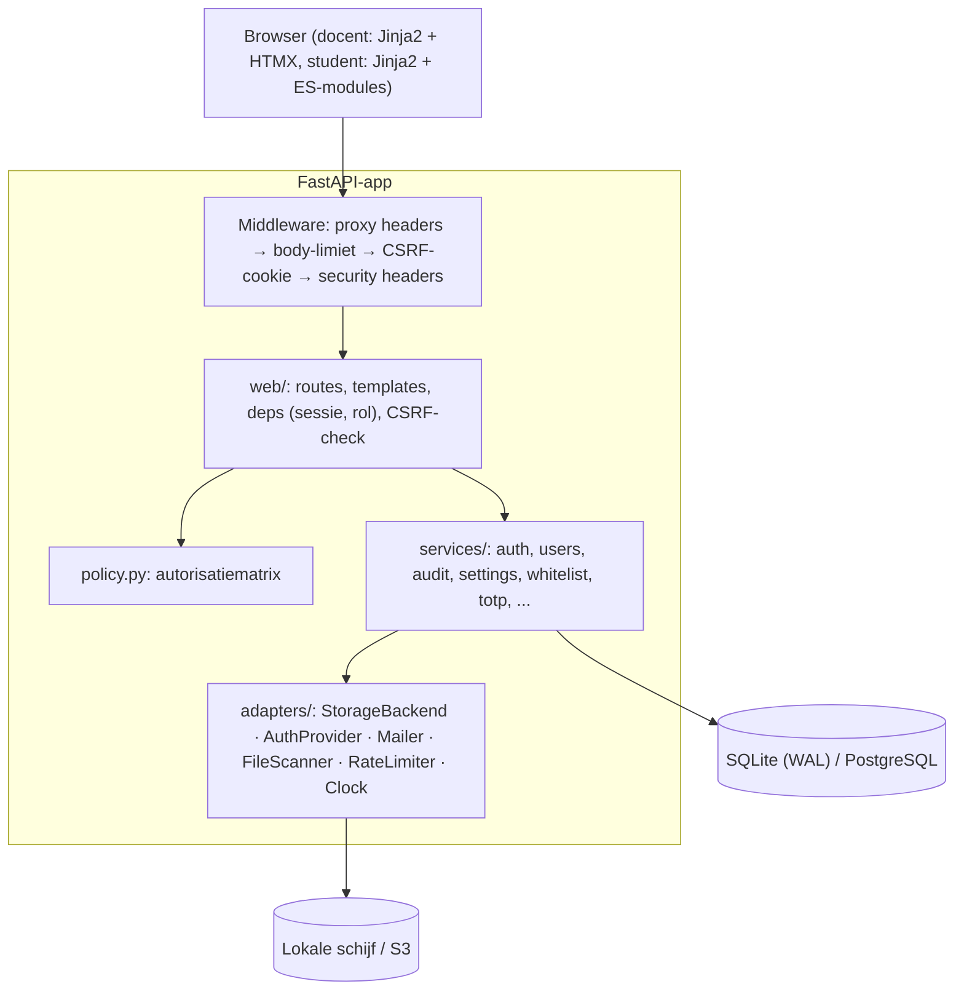
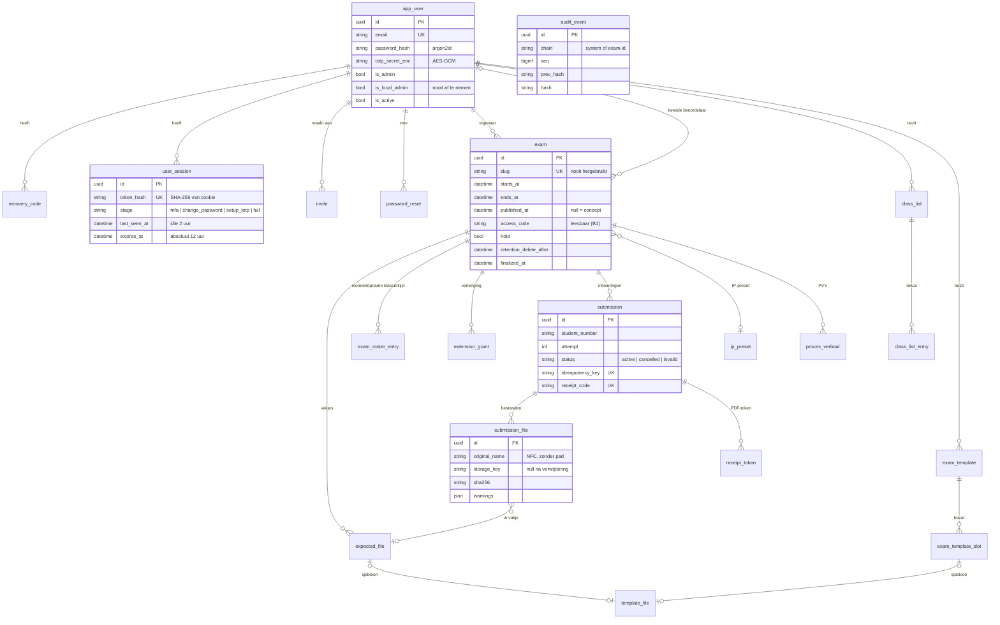
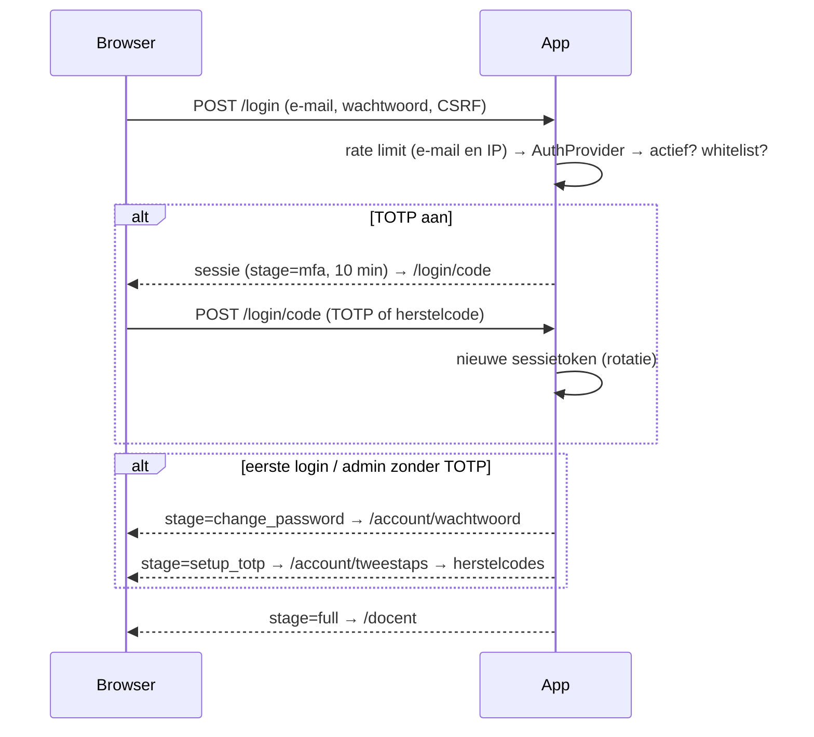

# Architectuur

## Lagen



- **web/** kent HTTP, maar heeft geen domeinlogica. Elke route vraagt rechten op via `deps.py`
  (`Teacher`, `Admin`) en `policy.py`.
- **services/** bevat de domeinlogica en heeft geen kennis van HTTP. Fouten zijn `DomainError` met
  een vaste code, en `web/messages.py` vertaalt die codes naar Nederlandse teksten.
- **adapters/** zijn de koppelingen met de buitenwereld. Elke adapter heeft een interface
  (`Protocol`), zodat OIDC, SMTP, ClamAV en Redis later zonder grote verbouwing passen.
- **Clock:** alle tijdafhankelijke code vraagt de tijd aan de `Clock`. Tests gebruiken een
  `FrozenClock` voor tijdvensters, sessies, DST en de bewaartermijn.

## Datamodel

Primaire sleutels zijn UUID v7. Alle tijden zijn timezone-aware en worden in UTC opgeslagen
(`UTCDateTime`). De status van een examen (concept, gepland, open, gesloten) wordt **afgeleid**
en niet opgeslagen. Alleen `finalized_at` (afgerond) staat in de database.



Losse tabellen, zonder relaties: `whitelist_entry`, `setting` (JSON-waarden), `branding_asset`,
`job_lock` (lease voor de scheduler), `retired_slug`, `denied_attempt_bucket` (geweigerde
pogingen per minuut samengevoegd), `audit_event` en `alembic_version`.

**Belangrijke constraints:**
- `uq_submission_one_active`: een partial unique index op `(exam_id, student_number)` met
  `WHERE status = 'active'`. Er is dus maximaal één actieve inlevering per student per examen,
  ook bij gelijktijdige pogingen. Dit werkt op zowel SQLite als PostgreSQL.
- `audit_event (chain, seq)` is uniek, en triggers weigeren `UPDATE` en `DELETE`. Het auditlog
  verwijst bewust niet met een foreign key naar `exam`, zodat het blijft bestaan na een
  definitieve verwijdering.

## Auditlog

```
hash = SHA-256( prev_hash ‖ canonical_json{chain, seq, ts, actor_type, actor_id,
                                           actor_label, ip, event, details} )
```

- Er is een keten per examen en één systeemketen. Het eerste item verwijst naar `"0" * 64`.
- `AuditService.append` schrijft in de transactie van de aanroeper, dus de wijziging en de
  logregel worden samen gecommit. Twee gelijktijdige schrijvers worden achter elkaar gezet door
  de unieke `(chain, seq)`: bij een conflict wordt een savepoint teruggedraaid en volgt een
  nieuwe poging. Op PostgreSQL wacht de tweede schrijver daarnaast via `FOR UPDATE` op de
  laatste rij.
- `inleverboks audit verify` rekent elke keten opnieuw door en meldt per keten de eerste breuk
  (`hash_mismatch`, `broken_link` of `seq_gap`).

## Authenticatie en sessies



- De cookie `ib_session` bevat een willekeurige token, met de vlaggen HttpOnly, SameSite=Lax en
  Secure. In de database staat alleen de SHA-256 van die token.
- Bij elke request worden gecontroleerd: intrekking, de absolute duur (12 uur), inactiviteit
  (2 uur), of het account nog actief is en of het adres nog op de whitelist staat. HTMX-polling
  (een element-id dat begint met `poll`) verlengt de sessie niet.
- Veranderen de eisen tijdens een sessie (iemand wordt admin, of TOTP wordt verplicht voor
  iedereen), dan wordt de sessie bij de volgende request teruggezet naar de juiste stap.
- De **local admin** is vrijgesteld van de whitelist. Zo kan de installatie zichzelf nooit
  buitensluiten.
- **CSRF:** een willekeurige waarde in de HttpOnly-cookie `ib_csrf`. Formulieren sturen
  `HMAC(SECRET_KEY, cookie)` mee, scripts sturen die in de header `X-CSRF-Token`. Daarnaast wordt
  de Origin gecontroleerd.

## Autorisatiematrix

Deze matrix staat in `policy.py` en wordt cel voor cel getest in `tests/unit/test_policy.py`.
De afwijking B4 uit het plan is verwerkt: een admin mag ook bij examens van anderen bestanden
downloaden en exporteren.

| Actie | Admin (examen van ander) | Eigenaar | Tweede beoordelaar | Andere docent |
|---|---|---|---|---|
| Instellingen, bestandseisen, tijden, code, IP wijzigen | ✗ | ✓ | ✗ | ✗ |
| Overzicht en metadata van inleveringen | ✓ | ✓ | ✓ | ✗ |
| Bestanden downloaden | ✓ (B4) | ✓ | ✓ | ✗ |
| Proces-verbaal en CSV | ✓ (B4) | ✓ | ✓ | ✗ |
| Auditlog van het examen | ✓ | ✓ | ✓ | ✗ |
| Ongedaan maken, ongeldig verklaren, verlenging | ✗ | ✓ | ✗ | ✗ |
| Bewaren-vlag | ✓ | ✓ | ✗ | ✗ |
| Eigendom overdragen | ✓ | ✗ | ✗ | ✗ |
| Afgerond examen definitief verwijderen | ✓ | ✗ | ✗ | ✗ |
| Ontvangstbewijs controleren | ✓ | ✓ | ✓ | ✗ |
| Concept verwijderen, dupliceren, als sjabloon opslaan | ✗ | ✓ | ✗ | ✗ |

Een admin die zelf eigenaar is van een examen heeft daarop ook alle rechten van een eigenaar.
Studenten hebben geen account. Er bestaat **geen enkele route** waarmee een student ingeleverde
bestanden kan opvragen.

## Studentflow

*(volgt in fase 4: sequence-diagram van openen → code → studentnummer → bestanden →
controle → upload → ontvangstbewijs.)*
